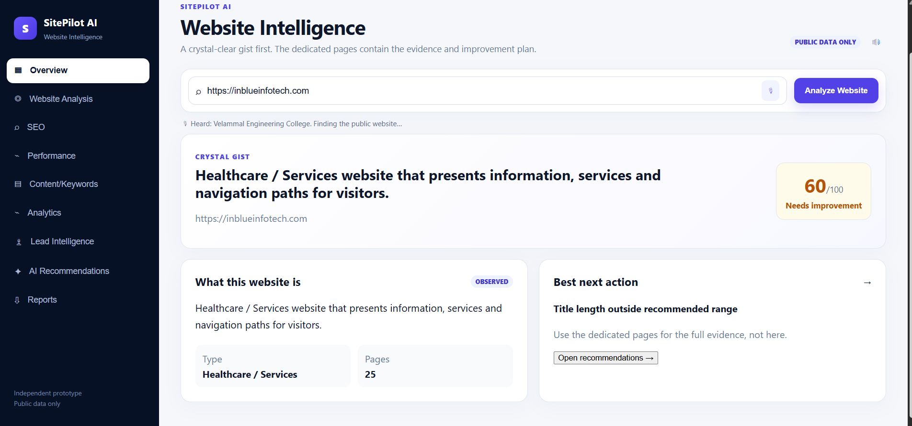
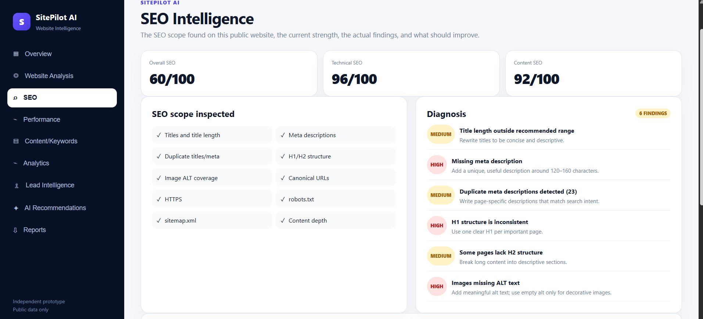
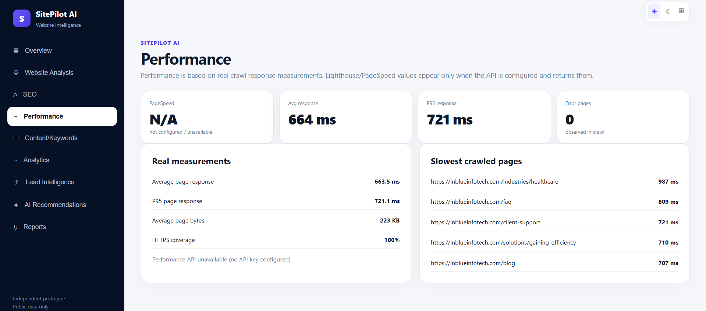
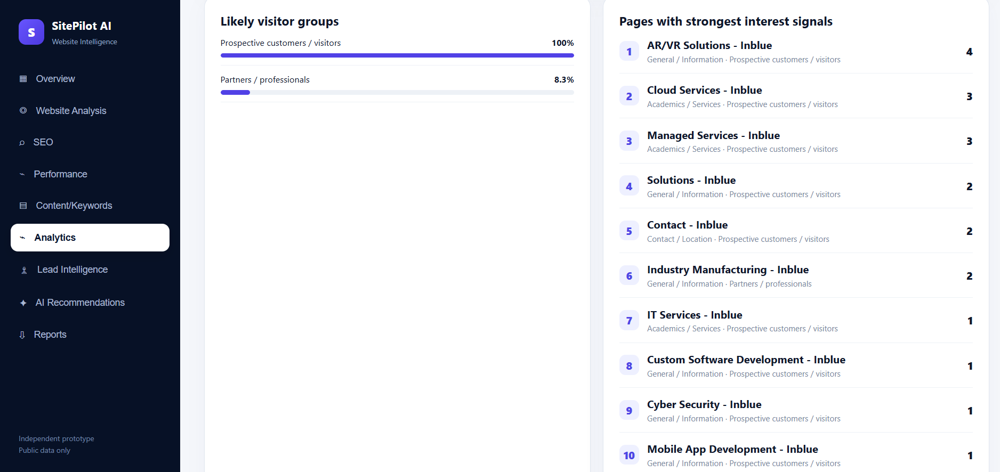
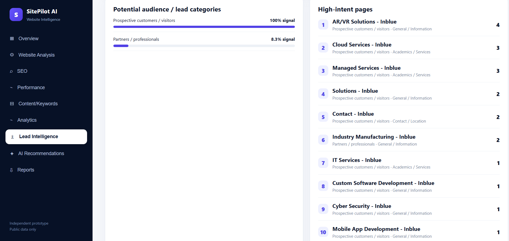
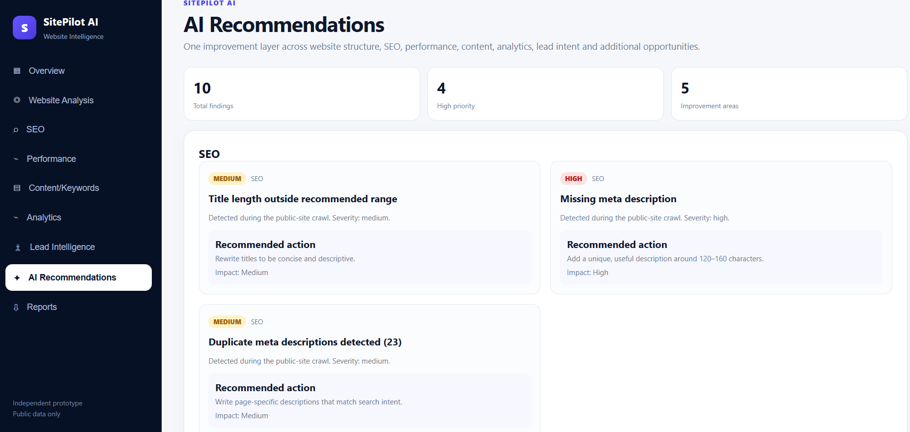
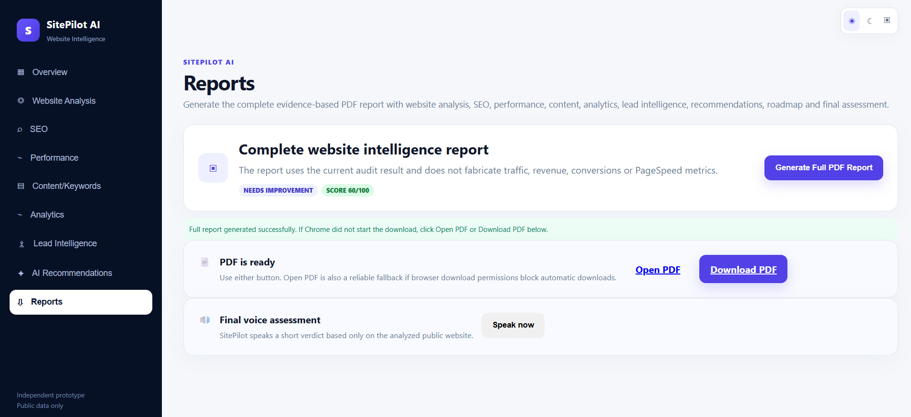

# 🚀 SitePilot AI

### AI-Powered Website Optimization & Digital Analytics Platform

SitePilot AI is a full-stack website intelligence platform that analyzes websites, identifies SEO and technical issues, and provides actionable recommendations through an interactive dashboard.

**No live deployment is currently available. Explore the screenshots below to see the project's interface and outputs.**

## ✨ Key Features

- 🌐 Website crawling and analysis
- 🔎 SEO health checks
- ⚡ Website performance insights
- 📝 Content and keyword analysis
- 📊 Interactive analytics dashboard
- 🤖 Machine-learning-based lead intelligence
- 💡 Prioritized optimization recommendations
- 📄 PDF report generation

## 🖥️ Project Screenshots

### 1. Dashboard Overview
The main dashboard provides an overview of website analysis and its results.



### 2. SEO Analysis
Displays SEO findings to help identify common website optimization issues.



### 3. Performance Insights
Presents available technical and website performance information.



### 4. Content & Keyword Analysis
Shows content-related findings, including word counts, headings, and keyword signals.


### 5. Digital Analytics
Displays summaries and insights from supported analytics data.



### 6. Lead Intelligence
Showcases the lead analysis interface powered by the project's Random Forest classifier.



### 7. Optimization Recommendations
Presents suggestions to help users prioritize website improvements.



### 8. PDF Reports
Shows the reporting interface for reviewing and generating website analysis reports.



## 🛠️ Technology Stack

| Component | Technologies |
|---|---|
| Frontend | React, Vite, Tailwind CSS |
| Backend | Python, FastAPI |
| Web Crawling | Requests, BeautifulSoup |
| Database | SQLite |
| Machine Learning | Random Forest |
| Data Visualization | Recharts |

## 🔄 How It Works

1. Enter a website URL.
2. Crawl accessible website pages.
3. Analyze SEO, technical, and content signals.
4. View results on the dashboard.
5. Explore recommendations and analytics.
6. Generate a structured PDF report.

## ⚙️ Run Locally

**Prerequisites:** Python, Node.js, npm, and Git.

Clone the repository:

```bash
git clone https://github.com/Nivedhitha2006/SitePilot-AI.git
cd SitePilot-AI
```

Start the backend in a terminal:

```powershell
cd backend
python -m venv .venv
.\.venv\Scripts\Activate.ps1
python -m pip install -r requirements.txt
python -m uvicorn app.main:app --reload
```

Start the frontend in a second terminal from the repository root:

```bash
cd frontend
npm install
npm run dev
```

Backend API: `http://localhost:8000`  
API Documentation: `http://localhost:8000/docs`

## 🚀 Future Enhancements

- Google PageSpeed Insights integration
- Google Analytics and Search Console integration
- Website monitoring and historical comparisons
- Enhanced predictive analytics

## 👩‍💻 Author

**Nivedhitha K**  
B.Tech Artificial Intelligence and Data Science  
Velammal Engineering College, Chennai

- GitHub: [Nivedhitha2006](https://github.com/Nivedhitha2006)
- LinkedIn: [Nivedhitha K](https://www.linkedin.com/in/nivedhitha-k-a9ab87301/)

---

⭐ **SitePilot AI — Turning website data into actionable intelligence.**
